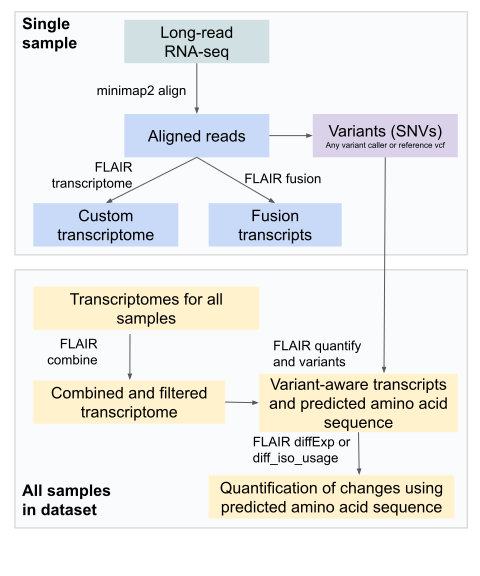

.. Flair documentation master file, created by
   sphinx-quickstart on Fri Jul  8 08:42:03 2022.
   You can adapt this file completely to your liking, but it should at least
   contain the root `toctree` directive.

Welcome to FLAIR's Documentation
=================================

Staying in touch and getting help
=================================

**Please subscribe to the FLAIR announce mailing list at:**

FLAIR Announce Group

   https://groups.google.com/a/ucsc.edu/g/flair-announce-group

This is a read-only, low volume list that will only have announcements of new
FLAIR releases, publications, and other FLAIR-related user information.

If you have questions, please ask in FLAIR GitHub Discussions:

   https://github.com/BrooksLabUCSC/flair/discussions

Report bugs to FLAIR GitHub Issues:

   https://github.com/BrooksLabUCSC/flair/issues
   

Installing FLAIR
================

See  :ref:`installing-label` for instructions on the various approache to install FLAIR.

Using FLAIR
===========

FLAIR can be run optionally with short-read data to help increase splice
site accuracy of the long read splice junctions. FLAIR uses multiple
alignment steps and splice site filters to increase confidence in the
set of isoforms defined from noisy data.FLAIR was designed to be able
to sense subtle splicing changes in nanopore data from `Tang et
al. (2020) <https://www.nature.com/articles/s41467-020-15171-6>`__.
Please read for more description of the methods.

See  :ref:`flair-protocol-label` for an outline of the approaches to running FLAIR.

If you have multiple samples and want to compare them on a single
transcriptome, you have two options:

Run ``flair transcriptome`` on each sample, then combine the transcriptomes with
``flair combine``, and count every sample's reads on the combined transcriptome
with ``flair quantify``.  This is the recommended approach: it is faster, and
each sample's isoforms keep their own support.

Your other option, for samples of few reads, is to merge replicates before
running ``flair transcriptome``, as one BAM, so low-expression transcripts gain
the reads to be assembled.  If using PacBio reads, be careful doing this, as the
reads may not have unique IDs: you may need to label each read with its sample
ID to keep the read IDs unique.  Either way, ``flair quantify`` then assigns the
reads of each sample individually to the isoforms for downstream analyses.

.. toctree::
   :maxdepth: 2
   :caption: Contents:

   installing.rst
   flair-protocol.rst
   running.rst
   migration-3.0-3.1.rst
   modules.rst
   ids.rst
   scripts.rst
   faqs.rst
   cite.rst

Indices and tables
==================

* :ref:`genindex`
* :ref:`modindex`
* :ref:`search`
