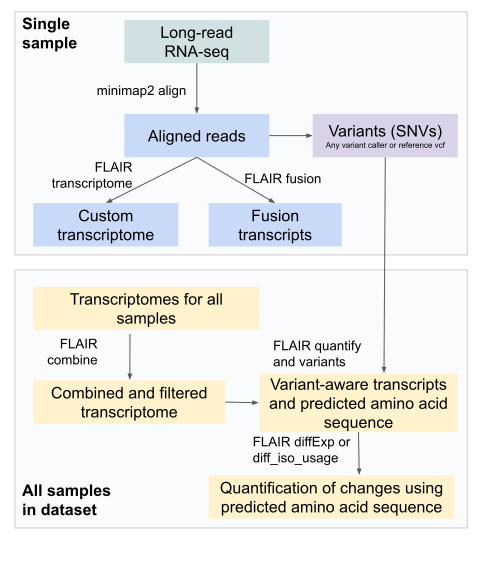

Welcome to FLAIR's Documentation
================================

FLAIR, Full-Length Alternative Isoform analysis of RNA, builds transcripts from long
reads aligned to a genome, counts them in each sample, and tests expression, isoform
usage and splicing between conditions.  It is used with nanopore cDNA, nanopore direct
RNA and PacBio reads.

Staying in touch and getting help
---------------------------------

The FLAIR announce list is read only and low volume, with announcements of new
releases, publications and other information for users:

   https://groups.google.com/a/ucsc.edu/g/flair-announce-group

Questions go to FLAIR GitHub Discussions:

   https://github.com/BrooksLabUCSC/flair/discussions

Bug reports go to FLAIR GitHub Issues:

   https://github.com/BrooksLabUCSC/flair/issues

Installing FLAIR
----------------

See :ref:`installing-label` for the ways to install FLAIR.

Using FLAIR
-----------

FLAIR builds isoforms from reads aligned to the genome, keeping only splice junctions
found in the annotation or in a file of supported junctions, which is how it builds a
transcriptome from noisy reads.  Short-read junctions can be given as that file, which
places splice sites more accurately.  The methods are described in `Tang et
al. (2020) <https://www.nature.com/articles/s41467-020-15171-6>`__.

See :ref:`flair-protocol-label` for an outline of the ways to run FLAIR.

Several samples compared on one transcriptome can be run two ways:

Run ``flair transcriptome`` on each sample, then combine the transcriptomes with
``flair combine``, and count every sample's reads on the combined transcriptome
with ``flair quantify``.  This is the recommended approach: it is faster, and
each sample's isoforms keep their own support.

The other way, for samples of few reads, is to merge replicates before running
``flair transcriptome``, as one BAM, so low-expression transcripts gain the reads
to be assembled.  Merging requires that the read ids be unique across the runs
merged, which :ref:`alignment-label` covers.  Either way, ``flair quantify`` then
assigns the reads of each sample individually to the isoforms for downstream
analyses.

.. toctree::
   :maxdepth: 2
   :caption: Contents:

   installing.rst
   flair-protocol.rst
   running.rst
   modules.rst
   ids.rst
   file-formats.rst
   scripts.rst
   migration-3.0-3.1.rst
   faqs.rst
   cite.rst

Indices and tables
==================

* :ref:`genindex`
* :ref:`search`
