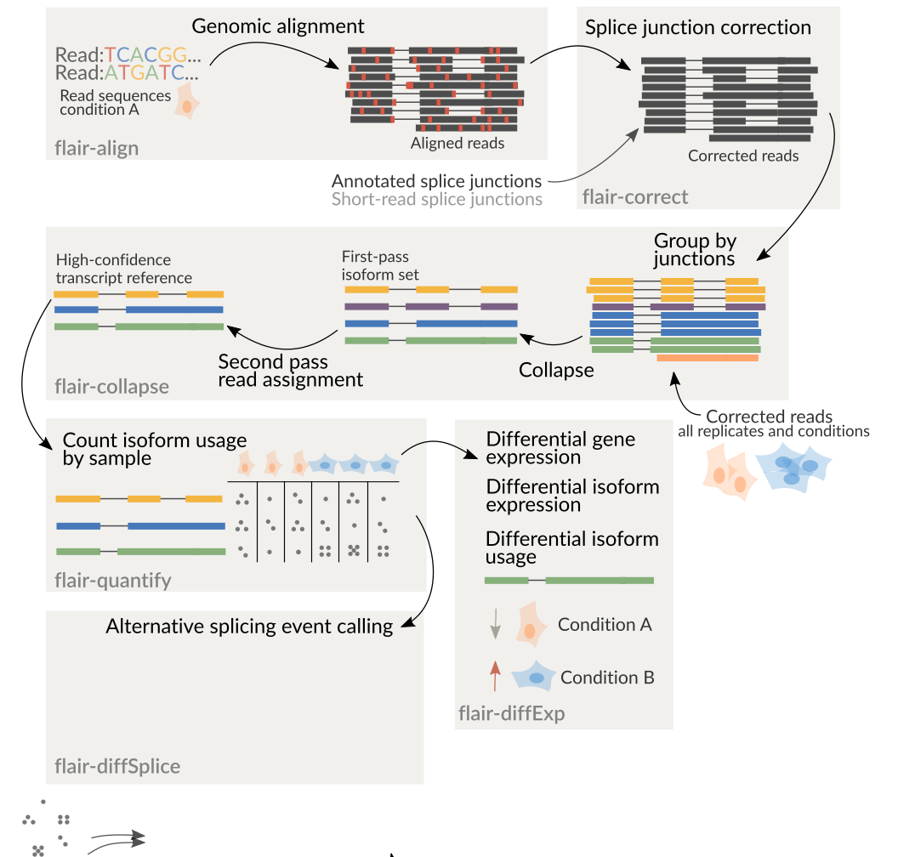
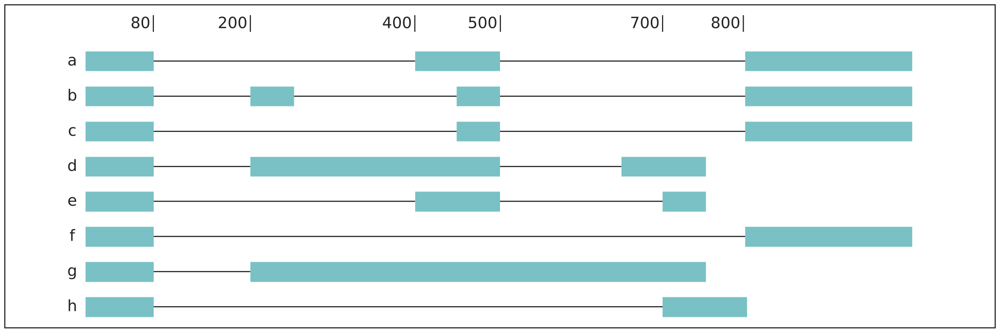

Modules
^^^^^^^

``flair`` is a program which implement the follow module sub-commands.

If you want to compare multiple samples, there are two primary ways of doing this:
 - Combine the fastq or fasta reads of all samples and run FLAIR transcriptome on all samples together (will generate the most comprehensive transcriptome)
 - Run FLAIR transcriptome on each sample separately (better for large sets of samples) and
   use FLAIR combine to merge results

.. _alignment-label:

Aligning reads to the genome
============================

FLAIR's modules take reads aligned to the genome as a sorted, indexed bam.  

Please see the protocols page with more details on pros and cons of different alignment options, but here is an explanation of minimap options if you chose to use minimap and want to customize your run.

The simplest protocol is to align with `minimap2 <https://github.com/lh3/minimap2>`__ and sort with samtools, in one line:

.. code:: sh

   minimap2 -ax splice -s 40 -G 350k -t 25 --MD --secondary=no genome.fa sample.fastq | samtools sort -o sample.genomealigned.bam - && samtools index sample.genomealigned.bam

The reads can be FASTA or FASTQ, gzipped or not. We recommend input with stranded reads without polyA tails trimmed, but unstranded and trimmed reads will work as well.

Options to consider:

``-ax splice``
    Spliced alignment of long reads, with SAM output. You can also use splice:hq with high-quality reads, although FLAIR has been tested with splice (optimized for lower-quality long-reads).
``-s 40``
    The minimum score of an alignment, roughly its length in matching bases: shorter
    pieces of a read are left unaligned.  For fusion detection, ``-s 40`` keeps shorter
    partner pieces, as a short 5' exon, and matches flair fusion's
    ``--min_fragment_size`` default.
``-G 350k``
    The longest intron.  Longer allows novel isoforms with long introns.  A fusion from
    a deletion between genes closer than this aligns as one spliced read, which flair
    fusion does not report: to find those, align with a smaller ``-G`` and lower flair
    fusion's ``--min_dist_between_breakpoints`` to match.
``--MD``
    Adds the MD tags that flair alleles and flair variantquant need to find the reads'
    mismatches.
``--secondary=no``
    Leaves out secondary alignments.  FLAIR uses each read's primary alignment, and
    flair fusion its supplementary ones.
``-t 20``
    Threads.
``-uf``
    For stranded reads, oriented 5' to 3' as their RNA: splice junctions are taken on
    the read's strand.  flair fusion needs stranded reads.
``--junc-bed annotation.bed``
    We do not recommend this option, as minimap2 tends to overcorrect to the submitted junctions

If you're using human sequences, the best reference genome is
`GCA_000001405.15_GRCh38_no_alt_analysis_set <ftp://ftp.ncbi.nlm.nih.gov/genomes/all/GCA/000/001/405/GCA_000001405.15_GRCh38/seqs_for_alignment_pipelines.ucsc_ids/GCA_000001405.15_GRCh38_no_alt_analysis_set.fna.gz>`__ as described in this
`helpful blog post by Heng Li <https://lh3.github.io/2017/11/13/which-human-reference-genome-to-use>`__.
If your input sequences are Oxford nanopore reads, please use `Pychopper <https://github.com/epi2me-labs/pychopper>`__ before aligning them.

.. _transcriptome-label:

flair transcriptome
===================

This module generates a transcriptome of high confidence isoforms (bed, gtf, and fasta files) directly from a bam file of
reads aligned to the genome, as :ref:`aligning reads to the genome <alignment-label>` describes.
For when to count splicing events from reads with flair spliceevents instead, see
:ref:`choosing-analysis-label`.

**Outputs**

 - ``flair.isoforms.bed``
 - ``flair.isoforms.gtf``
 - ``flair.isoforms.fa``
 - ``flair.read.map.txt``

Options
-------

.. include:: cli/transcriptome.rst

.. _fusions-label:

flair fusion
============

This identifies gene fusions and generates a fusion transcriptome. 
To incorporate this fusion transcriptome in downstream analysis, 
use flair combine to merge it with normal isoforms. 

Its input is a bam of all the reads aligned to the genome, as :ref:`aligning reads to the
genome <alignment-label>` describes, with ``-s 40`` to keep short partner pieces.

flair fusion requires stranded reads, each oriented 5' to 3' as its RNA.
The 5' and 3' genes of a fusion come from the order of a read's pieces, so a
reversed read gives the fusion backwards, which is then rejected as having its
5' gene in antisense.  Data that is poorly stranded, as some older PacBio
data, will miss fusions.

Each piece of a final fusion isoform gets its gene as flair transcriptome gives an
isoform its gene: by the annotated junctions and splice sites it shares with genes,
counting its splice sites at the fusion junctions, so a piece of only a gene's first
exon has its donor, and never by where reads end.  A piece with neither keeps the gene
of the preliminary fusion.  An isoform two of whose pieces are of one gene is left
out: flair fusion does not call rearrangements within a gene.

flair fusion is configured for human genomes: its paralog table and its filters of
immunoglobulin genes and mitochondrial fusions are human.  It has been tested with
GENCODE, RefSeq and Ensembl references, and recognises chromosomes as UCSC and GENCODE
(chr12), RefSeq (NC_000012.12) and Ensembl (12) name them, leaving out mitochondria and
unplaced scaffolds.

**Output**

sample.fusions.tsv
    Table of the fusions, most final reads first: the genes 5' to 3', those of its
    final isoforms, the reads of the preliminary fusion and of its final isoforms, the number of isoforms, the best
    supported breakpoint and isoform, and their reads.  A breakpoint is each junction
    between consecutive loci, in fusion order and comma-separated, as the last base of
    the 5' locus and the first base of the 3' one, 1-based, chrom:pos(strand)--chrom:pos(strand)
sample.fusions.isoforms.bed
    Bed file of fusion transcriptome, with a line for each locus of a fusion isoform and
    its position in the fusion in the pos_in_fusion column
sample.fusions.isoforms.gtf, sample.fusions.isoforms.bb
    The fusion transcriptome as GTF and bigBed
sample.fusions.isoforms.fa
    Fasta file of fusion transcriptome
sample.fusions.isoform.counts.txt
    Read counts of the fusion isoforms, as flair transcriptome's isoform.counts.txt
sample.fusions.isoform.read.map.txt
    read map of reads to fusion isoforms
sample.fusions.aaseq.tsv
    Protein sequences of the productive fusion isoforms, by the aaseq_id of the bed
sample.prelimfusions.bed
    The preliminary fusions' loci, with their reads and distances to a TSS
sample.genomealigned.chim.bam, sample.transcriptomealigned.chim.bam
    The chimeric reads of the genome alignment and of the alignment to annotated
    transcripts, reused by a later run with the same output name

With ``--keep_intermediate``, the synthetic fusion genome (sample-syntheticFusionGenome.fa),
its annotation, the reads aligned to it (sample.syntheticAligned.bam) and the other
intermediate files are kept as well, for viewing fusion isoforms on the synthetic genome.

Options
-------

.. include:: cli/fusion.rst

.. _combine-label:

flair combine
=============

Combines FLAIR transcriptomes with other FLAIR transcriptomes or annotation
transcriptomes to generate an accurate combined transcriptome. The transcriptomes to
combine are named in one of three mutually exclusive ways: --manifest, --prefixes or
--isoform_beds.

Manifest example, one bed file path per line (we suggest using absolute file paths to
point to your files though):

.. code:: text

    sample1.FLAIR.isoforms.bed
    sample2.FLAIR.isoforms.bed
    sample1.fusion.isoforms.bed
    sample2.fusion.isoforms.bed

To combine FLAIR transcriptomes with annotated transcripts, convert the annotation gtf
to a bed file with gtf_to_bed (see Additional Programs) and name that bed here.

Isoforms of the same splice junctions and strand from different samples are combined
into one.  We recommend giving flair combine an annotation GTF (``-f``).  Each combined
isoform then gets its gene, reference transcript, CDS and productivity from that
annotation, as flair transcriptome would give them, whatever annotation or FLAIR version
the samples were run with.  This lets samples run with different annotations be
combined.  The proteins are numbered anew, in ``combined.aaseq.tsv``.  Fusion isoforms
keep the samples' genes.  Without ``-f``, the samples' genes, CDS and productivity are
used, an isoform that samples gave different genes or reference transcripts is an
error, and isoforms have no protein ids, as each sample numbers its own.

Isoforms of alleles, from flair isoalleles, can be combined, but without their allele
information: the alleles of an isoform are combined into one isoform, with a warning.
Their support is per allele, so each allele is a smaller fraction of its gene's reads
than its isoform is, and ``--min_percent_usage`` should be set lower for them.  Either way, isoforms without an
annotated gene are grouped into novel genes as flair transcriptome groups them, and
isoform and gene ids are numbered in genome order, so they don't depend on the order
of the samples.

Flair combine will generate a counts file, but for the most accurate quantification, we recommend
running FLAIR quantify using all samples against the combined transcriptome

Options
-------

.. include:: cli/combine.rst

.. _quantify-label:

flair quantify
==============

**Output**

Default: identifes the best isoform assignment based on alignment quality, fraction of read aligned, and fraction of transcript aligned

check_splice: adds check for read matching reference transcript at all splice sites

stringent: adds requirement for read to cover at least 25bp of the first and last exons

If you need your reads to match your isoforms well, use --check_splice and --stringent, while if you need more reads assigned to isoforms for better statistical comparison, use the default.

--quality 0 is also reccommended, as this allows slightly better recall as FLAIR can disambiguate some similar isoform alignments.

Options
-------

Manifest example (we suggest using absolute file paths to point to your files though):

.. code:: text

   sample1      condition1      batch1  mydata/sample1.bam
   sample2      condition1      batch1  mydata/sample2.bam
   sample3      condition1      batch1  mydata/sample3.bam
   sample4      condition2      batch1  mydata/sample4.bam
   sample5      condition2      batch1  mydata/sample5.bam
   sample6      condition2      batch1  mydata/sample6.bam

.. include:: cli/quantify.rst

Other info
----------
The counts file names each column after the sample it holds:

.. code:: text

   ids  sample1 sample2 sample3 sample4 sample5 sample6
   ENST00000225792.10_ENSG00000108654.15   21.0    12.0    10.0    10.0    14.0    13.0
   ENST00000256078.9_ENSG00000133703.12    7.0     6.0     7.0     15.0    12.0    7.0

The condition and batch of each column are in ``<output>.sample_info.tsv``, written
beside the counts file, which `flair diffexp` and `flair diffsplice` read:

.. code:: text

   sample_id    condition       batch
   sample1      condition1      batch1
   sample2      condition1      batch1
   sample3      condition1      batch1
   sample4      condition2      batch1
   sample5      condition2      batch1
   sample6      condition2      batch1

Because these are columns of their own, the id, condition and batch fields may
contain any characters. A counts matrix from an earlier FLAIR, whose columns are
named ``sample_condition_batch``, is still read by taking the fields back out of the
column name.

.. _diffexp-label:

flair diffexp
=============

The standard `conda` environment no long installed `R` and the required packages.
These maybe added do the environment as describe in :ref:`installing-label` 

This module performs differential *expression* and differential *usage* analyses between **exactly two** conditions with 
3 or more replicates. Name the two conditions with ``--condition_a`` and ``--condition_b``;
``--condition_a`` is the reference, so fold changes are reported for ``--condition_b``
relative to it. With neither given, the two conditions are used in sorted order, which
makes the control the reference when its name sorts first (eg ctl and test). It does so
by running these R packages:

 - `DESeq2 <https://bioconductor.org/packages/release/bioc/html/DESeq2.html>`__ on genes and isoforms. This tests for differential expression.
 - `DRIMSeq <https://bioconductor.org/packages/release/bioc/html/DRIMSeq.html>`__ is used on isoforms only and tests for differential usage. This is done by testing if the ratio of isoforms changes between conditions.

If you do not have replicates you can use the `diff_iso_usage <#diffisoscript>`__ standalone script.

If you have more than two sample condtions, either split your counts matrix ahead of time or run DESeq2 and DRIMSeq yourself. 

**Outputs**

After the run, the output directory (``--output``) contains the following, where ``A``
is ``--condition_a`` and ``B`` is ``--condition_b``. Fold changes are reported for
``B`` relative to ``A``, so naming the conditions the other way round negates them
and renames these files.

 - ``genes_deseq2_A_v_B.tsv`` Filtered differential gene expression table.
 - ``genes_deseq2_QCplots_A_v_B.pdf`` QC plots, see the `DESeq2 manual <https://bioconductor.org/packages/release/bioc/vignettes/DESeq2/inst/doc/DESeq2.html>`__ for details.
 - ``isoforms_deseq2_A_v_B.tsv`` Filtered differential isoform expression table.
 - ``isoforms_deseq2_QCplots_A_v_B.pdf`` QC plots
 - ``isoforms_drimseq_A_v_B.tsv`` Filtered differential isoform usage table
 - ``isoforms_sig_exp_change_norm_by_gene.tsv`` Isoforms whose usage changes, from a t-test on counts normalized by gene.
 - ``workdir`` Temporary files including unfiltered output files.

Options
-------

.. include:: cli/diffexp.rst

Notes
-----

DESeq2 and DRIMSeq are optimized for short read experiments and expect many reads for each expressed gene. Lower coverage (as expected when using long reads) will tend to result in false positives.

For instance, look at this counts table with two groups (s and v) of three samples each:

.. code:: text

    gene   s1    s2      s3      v1      v2      v3
       A    1     0       2       0       4       2
       B  100    99     101     100     104     102

Gene A has an average expression of 1 in group s, and 2 in group v but the total variation in read count is 0-4. The same variation is true for gene B, but it will not be considered differentially expressed.

Flair does not remove low count genes as long as they are expressed in all samples of at least one group so please be careful when interpreting results.

Results tables are filtered and reordered by p-value so that only p<0.05 differential genes/isoforms remain. Unfiltered tables can be found in ``workdir``

.. _diffsplice-label:

flair diffsplice
================

The standard `conda` environment no long installed `R` and the required packages.
These maybe added do the environment as describe in :ref:`installing-label` 

This module calls alternative splicing (AS) events from isoforms. Currently supports
the following AS events: 

 - intron retention (ir)
 - alternative 3’ splicing (alt3)
 - alternative 5’ splicing (alt5)
 - cassette exons (es)

If there are 3 or more samples per condition, then you can run with
``--test`` and DRIMSeq will be used to calculate differential usage of
the alternative splicing events between two conditions. See below for
more DRIMSeq-specific arguments. 

If conditions were sequenced without replicates, then the diffSplice output files can
be input to the `diffsplice_fishers_exact <#diffsplice_fishers>`__
script for statistical testing instead.

**Outputs**

After the run, the output directory (``--output``) contains the following tab separated files:

 - ``diffsplice.alt3.events.quant.tsv``
 - ``diffsplice.alt5.events.quant.tsv``
 - ``diffsplice.es.events.quant.tsv``
 - ``diffsplice.ir.events.quant.tsv``

If DRIMSeq was run, where ``A`` is ``--condition_a`` and ``B`` is ``--condition_b``:

 - ``drimseq_alt3_A_v_B.tsv``
 - ``drimseq_alt5_A_v_B.tsv``
 - ``drimseq_es_A_v_B.tsv``
 - ``drimseq_ir_A_v_B.tsv``
 - ``workdir`` Temporary files including unfiltered output files.

Options
-------

.. include:: cli/diffsplice.rst

Notes
-----

Results tables are filtered and reordered by p-value so that only p<0.05 differential genes/isoforms remain. Unfiltered tables can be found in ``workdir``

For a complex splicing example, please note the 2 alternative 3’ SS, 3
intron retention, and 4 exon skipping events in the following set of
isoforms that ``flair diffSplice`` would call and the isoforms that are
considered to include or exclude the each event:

.. code::

   a3ss_feature_id     coordinate                  sample1 sample2 ... isoform_ids
   inclusion_chr1:80   chr1:80-400_chr1:80-450     75.0    35.0    ... a,e
   exclusion_chr1:80   chr1:80-400_chr1:80-450     3.0     13.0    ... c
   inclusion_chr1:500  chr1:500-650_chr1:500-700   4.0     18.0    ... d
   exclusion_chr1:500  chr1:500-650_chr1:500-700   70.0    17.0    ... e

.. code::

   ir_feature_id           coordinate      sample1 sample2 ... isoform_ids
   inclusion_chr1:500-650  chr1:500-650    46.0    13.0    ... g
   exclusion_chr1:500-650  chr1:500-650    4.0     18.0    ... d
   inclusion_chr1:500-700  chr1:500-700    46.0    13.0    ... g
   exclusion_chr1:500-700  chr1:500-700    70.0    17.0    ... e
   inclusion_chr1:250-450  chr1:250-450    50.0    31.0    ... d,g
   exclusion_chr1:250-450  chr1:250-450    80.0    17.0    ... b

.. code::

   es_feature_id           coordinate      sample1 sample2 ... isoform_ids
   inclusion_chr1:450-500  chr1:450-500    83.0    30.0    ... b,c
   exclusion_chr1:450-500  chr1:450-500    56.0    15.0    ... f
   inclusion_chr1:200-250  chr1:200-250    80.0    17.0    ... b
   exclusion_chr1:200-250  chr1:200-250    3.0     13.0    ... c
   inclusion_chr1:200-500  chr1:200-500    4.0     18.0    ... d
   exclusion_chr1:200-500  chr1:200-500    22.0    15.0    ... h
   inclusion_chr1:400-500  chr1:400-500    75.0    35.0    ... e,a
   exclusion_chr1:400-500  chr1:400-500    56.0    15.0    ... f

.. _spliceevents-label:

flair spliceevents
==================

For when to count splicing events from reads rather than build isoforms, see
:ref:`choosing-analysis-label`.

This module counts alternative splicing events in each sample directly from its
reads aligned to the genome, without building isoforms first, so it suits
fragmented or degraded libraries and datasets of variable quality, which flair
transcriptome handles less well.  Its events resemble flair diffsplice's, but they are
counted from reads, while diffsplice derives them from isoforms and their counts, so
the two are separate analyses, not steps of one.  Reads are corrected against the annotation, and
optionally short-read junctions, as flair transcriptome corrects them, and assigned to
genes as flair transcriptome assigns them: to annotated genes, a read through two genes
to both, and reads of no annotated gene, over all samples, to novel genes named for
their locus.  Unspliced reads count only as fragments, for starts and ends: one
whose 5' end lies in an annotated last exon, or within 100 bases before it, is a 3'
fragment, whose end counts as one of the gene's transcript ends, and one whose 3' end
lies in an annotated first exon is a 5' fragment, whose start counts as a start.  A
read overlapping several genes' exons is the fragment of the one whose exons share the
most bases with it, if it's at that gene's first or last exon; a tie leaves it out.
Without ``--trust_strand``, the genes of both strands count, as an unspliced read's
strand isn't known.  The first and last exons are those of ``--annot_basic``, if given.  Other unspliced reads are left out.  It finds these
events:

 - exon skipping (es), and complex exon skipping (ces): a skipping junction against
   every way the reads include the exons between its ends, several exons, or one
   exon with alternative splice sites
 - alternative 5' and 3' splice sites (alt5, alt3), and alternative 5' and 3'
   splice sites shared by a group of junctions (alt5ss, alt3ss)
 - intron retention (ir)
 - alternative first and last exons (afe, ale): only exons whose junction reads,
   over all samples together, rarely have an exon before (or after) them count, as
   a truncated read makes an internal exon look like a first or last one
 - alternative transcription starts and ends (tss, tts)

Each event has a row for each of its alternatives, such as an exon's inclusion and
exclusion, and an ``other`` row for its reads that fit none of them.  An event is
found from its alternatives of at least ``--feature_support`` reads in some sample
whose PSI varies across the samples by ``--junc_frac_of_event``.  An alternative that
doesn't vary is a row too when it has a tenth of the event's reads in some sample, as
its main one often does, and the reads of the rest are its ``other`` row.

The events of splicing (es, ces, alt5, alt3, alt5ss, alt3ss, ir) are found among
reads linked by shared splice sites, whatever their genes, so overlapping genes and
readthroughs don't split an event's reads.  Each is then given the gene annotated
with most of its introns, those of all its alternatives, the ``other`` row's too:
each intron scores 2 for a gene annotated with it, or failing that 1 for each of its
splice sites the gene has, weighted by the intron's share of the reads of all the
event's introns, so a rare alternative counts little.  A tie goes to the gene of more annotated transcripts, so
a gene rather than a readthrough of it.  Genes still tied are all given, comma-separated.
An event sharing no intron or splice site with the annotation, as in a novel gene,
gets the gene of most of its reads.  First and last exons and starts and ends are
found per gene: a read's first exon and start with the gene it starts in, its last
exon and end with the gene it ends in.

An event is named ``TYPE|CHROM:START-END(STRAND)``, its locus, 1-based, being
its skipped exon for es, and otherwise the outer bounds of its introns, so it can be
pasted into a genome browser.  Each row is one alternative of its event, named by
what sets it apart from the event's other rows: ``inc`` and ``exc`` for es and
``exc`` for ces, the exons
included of a ces's other rows, ``retained`` and ``spliced`` for ir, the introns of
each alternative of alt5, alt3, alt5ss, alt3ss, afe and ale, the position of each
end of tss and tts, and ``other``.  Introns are written as STAR writes them, from
their first base to their last, and exons from their first base to their last.
For example, an exon skip and an alternative 3' splice site::

   es|chr12:25215437-25215560(-)    inc
   alt3|chr1:201-350(+)             201-300

The tables' coordinate columns use the same 1-based coordinates.  An event's PSI
is computed two ways: of the event's reads (PSIjunc), which is more sensitive, and of
all reads covering the event's locus (PSItot), which favours events that are strong
overall.  A sample needs ``--event_support`` reads of an event for a PSI.

With ``--region_bed``, only events inside its regions are reported: those whose
junctions and exons all lie in a region, whose reads all overlap it, and the start,
end, first and last exon events of genes whose annotated junctions (a novel gene's
reads' junctions) all lie in one, so a region around a gene's annotated exons, or only
its spliced part, reports them.
Reads overlapping a region are corrected over their whole length, wherever the region
ends.  The samples of a region are corrected in parallel.

Without ``--region_bed``, each chromosome is cut in intergenic gaps of the annotation
into pieces of about 5000 annotated exons, which are corrected and searched for events
in parallel.  A piece owns the reads starting in it, corrected over their whole length,
and reports the events starting in it, so an event close to a cut can miss the reads
of the piece before.  Reads are aligned to their piece's annotated transcripts, not
the whole chromosome's.  ``--partition no`` keeps chromosomes whole, slower but
without those losses, and ``--partition yes`` cuts ``--region_bed`` regions too.

The manifest is a tab-separated file of a sample name and the path to its sorted and
indexed bam file, a line per sample::

   sample1	sample1.genomealigned.bam
   sample2	sample2.genomealigned.bam

**Outputs**

 - ``OUTPUT.spliceevents.counts.tsv``, the reads of each event row in each sample,
   with the row's ``event``, ``alternative``, ``event_type``, ``gene`` and
   ``gene_name``, the annotation's name of the gene, empty if it has none,
   ``additional_genes`` and ``additional_gene_names``, the other annotated genes
   sharing an intron or splice site with a splicing event, best scoring first, to
   find all the events that could be a gene's, and its
   ``junctions_included``, ``junctions_excluded``, ``outer_junctions`` and
   ``exons``, and ``novel_junctions``, the row's introns that aren't annotated:
   those its reads splice, the skipping junctions of an exon skip's exclusion.  An
   event of an annotated gene can have novel alternatives, so these, rather than
   the gene, find novel splicing
 - ``OUTPUT.spliceevents.PSIjunc.tsv`` and ``OUTPUT.spliceevents.PSItot.tsv``, the
   rows' PSIs, empty where a sample has too few reads
 - ``OUTPUT.spliceevents.totals.tsv``, each event's reads (``event_reads``) and the
   reads covering its locus (``locus_reads``) in each sample, the PSIs' denominators
 - ``OUTPUT.spliceevents.bed``, the event rows for a genome browser, named
   ``EVENT|ALTERNATIVE`` and scored by their median PSIjunc

Outlier samples, whose PSI of an event is far from the other samples', can be found
from these tables with the `spliceevents_outliers <scripts.html#spliceevents-outliers>`__
script.

Options
-------

.. include:: cli/spliceevents.rst

.. _variantquant-label:

flair variantquant
==================

Quantifies variants at genome positions using reads aligned to the transcriptome.
Sites to check are named either with a vcf, with a reference position file, or per
sample through a manifest.

Options
-------

.. include:: cli/variantquant.rst

.. _alleles-label:

flair alleles
=============

Calls alleles from variants and groups the reads that carry them, writing a vcf of
allele groups.  A normal bam and vcf may be given alongside the tumor ones to call
variants as somatic or not.

Options
-------

.. include:: cli/alleles.rst

.. _isoalleles-label:

flair isoalleles
================

Groups alleles by isoform, using the allele calls from flair alleles together with an
isoform bed, and predicts the protein each isoform allele produces.

Options
-------

.. include:: cli/isoalleles.rst
