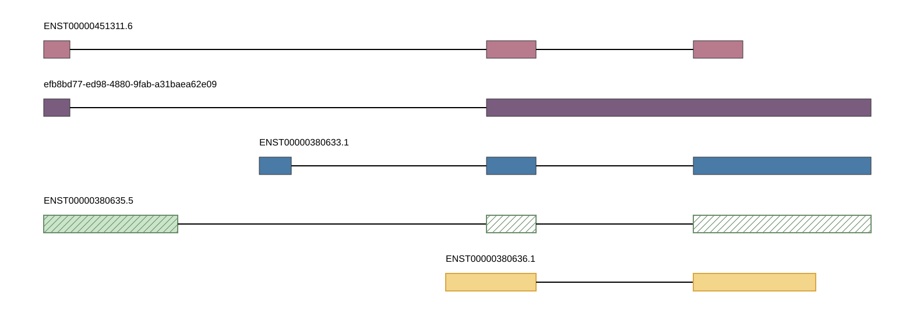
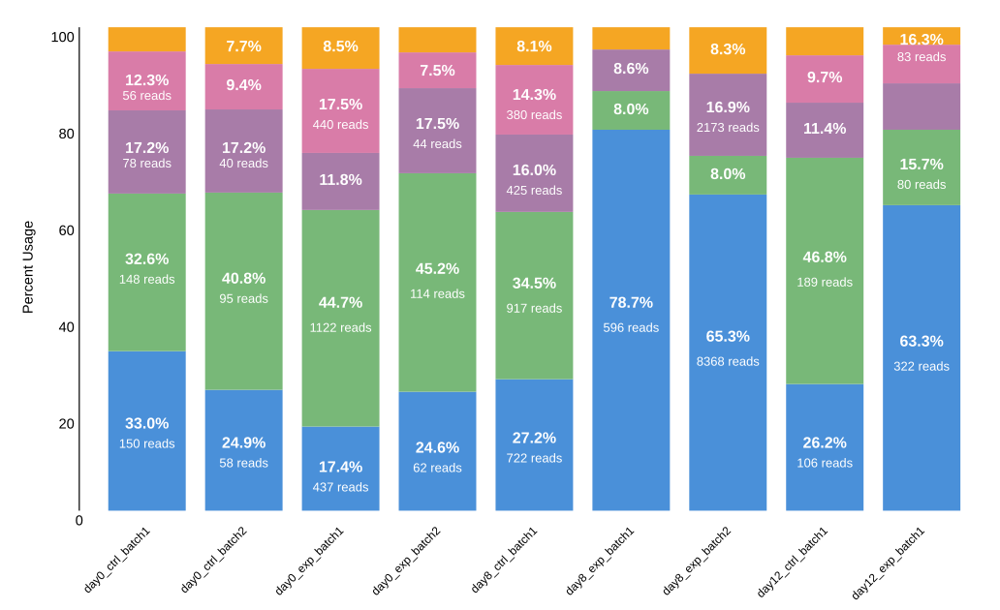

.. _scripts-label:

Additional programs
^^^^^^^^^^^^^^^^^^^

A ``conda install`` or ``pip install`` of FLAIR puts these programs on ``PATH``.
The options of each are generated from the program itself, so they are what the
program accepts.

Each reads a gzipped input and writes a gzipped output when the file name ends in
``.gz``, reports a missing input by naming it, and takes the logging options of
``flair`` itself, so ``--log-level`` and ``--log-debug`` work as they do there.

bed_to_gtf
==========

.. include:: cli/bed_to_gtf.rst

Convert isoforms in BED12 format to a GTF, written to standard output.

**Output**

A GTF of a ``gene`` record per gene and a ``transcript`` and ``exon`` record per
isoform, with ``CDS`` records from each isoform's thick range unless ``--no_cds``.
The gene of an isoform is the BED's ``gene_id`` column, which only a FLAIR BED has:
another BED needs ``--force``, which uses each isoform's name as its gene.  The
isoforms converted are reported, and a BED with none of them is a warning.

.. _diff-iso-usage-label:

diff_iso_usage
==============

.. include:: cli/diff_iso_usage.rst

Compares the usage of each isoform, its share of its gene's reads, between two
samples, and tests the change with Fisher's exact test: the more the usage differs
between the first and the second sample, the lower the p-value.

It also reads the counts of ``flair spliceevents``, comparing an event's alternatives
against the rest of the event, as ``flair diffexp`` does (see :ref:`diffexp-label`).  An
event's ``other`` row counts toward the rest but has no row of its own.

Output file format columns are as follows, where the two sample names are the ones
given on the command line, so the direction of ``delta_PSI`` can be read from the file:

 - gene name
 - isoform name
 - p-value, ``fisher_pval``
 - the p-value adjusted for the number of isoforms tested, ``fisher_adj_pval``, by
   Benjamini-Hochberg, so a cutoff on it bounds the false discovery rate.  Filter on
   this one: with thousands of isoforms tested, a raw p-value below 0.05 is expected
   by chance alone for one in twenty of them.  An isoform that cannot be tested is NA
   in both
 - this isoform's count in each of the two samples
 - the gene's other isoforms' counts in each of the two samples
 - each sample's PSI, and the difference between them

For a large input, ``--min_expression N`` cuts what is tested without biasing the
adjusted p-values.  It leaves an isoform of fewer than N reads in the two samples
together untested, as ``flair diffexp --min_expression`` leaves out isoforms of few
reads.  The filter is on the total, which Fisher's test conditions on, so it is
independent of the p-value when nothing changed: the isoforms left out could not
have been significant, and the rest gain power from fewer tests.  Filtering on
each sample's reads, or on the change, would not be independent: a filter on the
change would make the adjusted p-values too small, since the change and the
p-value come from the same counts.  To report only large changes, filter the
output on ``delta_PSI`` after the run.

.. _diffsplice-fishers-exact-label:

diffsplice_fishers_exact
========================

.. include:: cli/diffsplice_fishers_exact.rst

Identifies and calculates the significance of alternative splicing
events between two samples without replicates using Fisher's exact
tests, from a ``flair diffsplice`` TSV of alternative splicing calls for
one splicing event type.

**Output**

The output file contains the original columns with an additional column
containing the p-values appended.

fasta_seq_lengths
=================

.. include:: cli/fasta_seq_lengths.rst

The length of every sequence of a FASTA, for checking a genome or a transcriptome
against the sequence names and lengths of an alignment.

**Output**

A TSV of ``name`` and ``length``, a row per sequence, in file order.  Given a second
output name, a histogram as well: a TSV of ``length`` and the number of sequences of
that length, in order of length.  The sequences measured are reported, and a file
with none of them is a warning.

flair_partition
===============

.. include:: cli/flair_partition.rst

Defines non-overlapping regions across all of the input files, which is how FLAIR
splits work across threads.  A partition is a cluster of reads and annotated
transcripts that overlap, so no read and no transcript crosses one, and what a
partition contains does not depend on how many threads a run uses
(dev/design/clusters-and-partitions.md).

**Output**

A BED4 of the partitions in position order, with the number of input items in each
as a fifth column.  The counts of the partitions, and the distribution of their
sizes, are logged at ``INFO``.

gtf_to_bed
==========

.. include:: cli/gtf_to_bed.rst

Convert the transcripts of an annotation GTF to a BED12, one row per transcript,
with its exons as blocks and its CDS as the thick range.

**Output**

A BED12 in position order, the transcript id as the name.  With ``--include_gene``,
a thirteenth column of the gene id, which is how FLAIR writes a gene rather than
joining it to the transcript id.  The transcripts converted are reported, and a GTF
with none of them is a warning: a file that is not a GTF of transcript and exon
records converts to an empty BED.

Convert a GTF to a BED12 file.

mark_intron_retention
=====================

.. include:: cli/mark_intron_retention.rst

Assumes the BED has the correct strand information.

**Outputs**

 - the input BED with a ``retains_intron`` column added, 1 when another isoform of the
   locus has an exon where this one has an intron, 0 otherwise.  A header line names the
   columns, so the file is a TSV rather than a BED.
 - a TSV of the retained introns, with columns ``chrom``, ``start``, ``end`` and
   ``strand``.  An intron appears once however many isoforms retain it.

plot_isoform_usage
==================

.. include:: cli/plot_isoform_usage.rst

Plots the isoform structures of one gene and the percent usage of each of its
isoforms in each sample.  The gene name given must be one of the gene names in the
isoform file and the counts file.  Given the isoforms.bed of
``predictProductivity``, each isoform is filled according to its predicted
productivity: solid for ``PRO``, hatched for ``PTC``, faded for ``NGO`` or ``NST``.

The isoforms plotted are the most highly expressed across all the samples; the minor
ones are aggregated into a gray bar.  ``--min_reads`` and ``--palette`` plot more of
them.

**Outputs**

 - gene_name_isoforms.pdf of isoform structures
 - gene_name_usage.pdf of isoform usage by sample

With ``-o``, the prefix comes before the gene name.

For example:

.. _spliceevents-outliers-label:

spliceevents_outliers
=====================

.. include:: cli/spliceevents_outliers.rst

Finds outlier samples of the splicing events from ``flair spliceevents``: samples
whose PSI of an event is far from the median of all samples', at least 0.1 from
it and more than 3 deviations (half the interquartile range), of events where at
least 5 samples have ``--event_support`` reads.  It reads
``OUTPUT.spliceevents.counts.tsv`` and ``OUTPUT.spliceevents.totals.tsv``, and
calls outliers of either PSI: ``--psi junc``, of the event's reads, which is more
sensitive, or ``--psi tot``, of the reads covering the event's locus, which finds
strong overall events.

**Outputs**

 - ``OUTPUT.spliceevents.outliers.tsv``, every outlier
 - ``OUTPUT.spliceevents.outliers.filtered.tsv``, the outliers more than 6
   deviations from the median that a simpler event of the same junctions does not
   explain as well: a complex exon skip by an exon skip, and an alternative
   splice site by an exon skip or a complex exon skip

.. note::

   Starts and ends (tss and tts) are left out of the filtered outliers on
   purpose.  Their events, from read ends, give far too many false positive
   outliers for now.  They are still in ``OUTPUT.spliceevents.outliers.tsv``.
